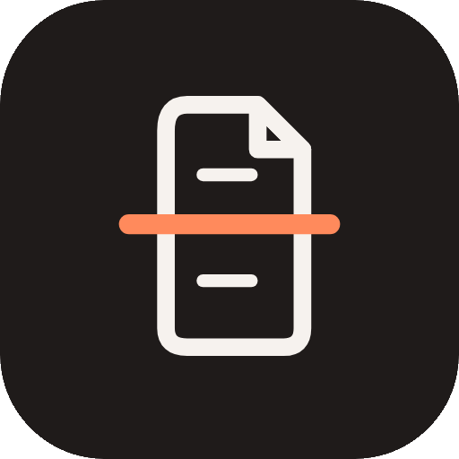

<div align="center">
  

  <h1>Pedeef: Peralatan PDF Offline untuk Android</h1>

  <p><b>Semua alat PDF yang kamu butuhkan dalam satu aplikasi gratis.<br/>Semuanya berjalan di ponselmu, file tetap di Download/Pedeef.</b></p>

  <a href="https://github.com/nekonaru/pedeef/releases/latest">
    
  </a>
  <a href="https://github.com/nekonaru/pedeef/actions/workflows/ci.yml">
    
  </a>
  
  
  
  
</div>

<br />

[English](README.md) | **Bahasa Indonesia**

---

## Daftar Isi

- [Tentang](#tentang)
- [Fitur](#fitur)
- [Kebutuhan](#kebutuhan)
- [Instalasi](#instalasi)
- [Penggunaan](#penggunaan)
- [Konfigurasi](#konfigurasi)
- [Struktur Proyek](#struktur-proyek)
- [Pengembangan](#pengembangan)
- [Pengujian](#pengujian)
- [Integrasi Berkelanjutan](#integrasi-berkelanjutan)
- [Tanya Jawab](#tanya-jawab)
- [Lisensi](#lisensi)

---

## Tentang

Pedeef adalah peralatan PDF gratis untuk Android. Pedeef menggabungkan, memisahkan, mengompres, memindai, melakukan OCR, meredaksi, menandatangani dan melindungi file PDF, semuanya di perangkat, tanpa akun dan tanpa akses jaringan.

Pedeef adalah implementasi ulang asli dari aplikasi open source PDF Tools (MIT, (c) 2026 SammyZi), dengan arsitektur yang dibangun ulang, UI dwibahasa dan alat-alat baru miliknya sendiri.

> _"Dokumenmu tidak pernah keluar dari ponsel kecuali kamu sendiri yang mengirimnya."_

---

## Fitur

### Pindai

| Fitur | Deskripsi |
|-------|-----------|
| **Pindai kamera** | Pemindaian dokumen di perangkat dengan deteksi tepi otomatis, perapihan sudut dan deskew. |
| **Impor galeri** | Gambar dari galerimu menjadi pindaian yang sama, satu halaman per gambar. |
| **Pindaian dapat dicari** | Lapisan OCR opsional (teks tak terlihat) ditanam ke PDF yang tersimpan, dikerjakan di perangkat. |

### Gabung dan pisah

| Fitur | Deskripsi |
|-------|-----------|
| **Gabung PDF** | Gabungkan banyak PDF menjadi satu; urutkan file sebelum menggabung. |
| **Selang-seling & Campur** | Selingi halaman dua PDF atau lebih, bergiliran satu halaman untuk tiap file. |
| **Pisah** | Setiap halaman menjadi file sendiri, atau ekstrak rentang kustom seperti `1-3, 7, 9-`. |
| **Pisah berdasarkan Teks** | Mulai file baru pada setiap halaman yang memuat frasa pilihanmu. |
| **Pisah berdasarkan Bookmark** | Ubah setiap bagian bookmark menjadi PDF tersendiri. |
| **Pisah Jadi Dua** | Dua file dipisahkan di tengah, atau iris setiap halaman vertikal atau horizontal untuk pindaian buku. |
| **Pisah berdasarkan Ukuran** | Bagi PDF besar menjadi bagian yang masing-masing di bawah batas ukuran. |
| **PDF ke ZIP** | Gabungkan PDF menjadi satu arsip ZIP. |

### Atur halaman

| Fitur | Deskripsi |
|-------|-----------|
| **Atur Halaman** | Urutkan ulang, putar dan hapus halaman, dengan thumbnail halaman. |
| **Putar** | 90, 180 atau 270 derajat, semua halaman atau rentang terpilih. |
| **Balik** | Cerminkan halaman secara horizontal, vertikal atau keduanya. |
| **Beberapa Halaman per Lembar** | 2, 4, 6, 9 atau 16 halaman per lembar untuk dicetak. |
| **Pangkas & Ubah Ukuran** | Seret bingkai pangkas per halaman, atau muat setiap halaman ke A4, A5, Letter atau Legal. |

### Isi dan tandai

| Fitur | Deskripsi |
|-------|-----------|
| **Isi & Tanda Tangan** | Ketik pada formulir, letakkan gambar tanda tangan atau gambar apa pun di mana pun pada halaman. |
| **Watermark** | Teks diagonal seperti CONFIDENTIAL pada setiap halaman, ukuran dan opasitas bisa diatur. |
| **Nomor Halaman** | Bawah kiri, tengah atau kanan; format `1, 2, 3` atau `Halaman 1 dari N`. |
| **Redaksi** | Hitamkan area sehingga isinya benar-benar dihapus, bukan sekadar ditutup. |
| **Edit Detail PDF** | Judul, penulis, subjek dan kata kunci. |

### Lindungi dan perkecil

| Fitur | Deskripsi |
|-------|-----------|
| **Kompres** | Kompres ulang foto yang tertanam ke level tertentu, atau perkecil sampai file muat batas ukuran yang kamu tentukan. |
| **OCR** | Tambahkan lapisan teks tak terlihat pada pindaian sehingga cari, pilih dan salin berfungsi. |
| **Setel Kata Sandi** | Enkripsi AES-256; PDF meminta kata sandi sebelum terbuka. |
| **Hapus Kata Sandi** | Simpan salinan yang terbuka tanpa kata sandi, batasan juga dihapus. |

### Otomatisasi

| Fitur | Deskripsi |
|-------|-----------|
| **Pembuat Workflow** | Rangkai alat apa pun berurutan dan jalankan pada satu atau banyak PDF. |
| **Mode batch** | Alat satu-file berjalan pada setiap PDF yang dipilih sekaligus. |
| **Sematan** | Sematkan alat yang paling sering kamu pakai di bagian atas Home. |

### Baru di Pedeef

| Fitur | Deskripsi |
|-------|-----------|
| **Gambar ke PDF** | Ubah gambar JPG dan PNG menjadi satu PDF, satu halaman per gambar. |
| **PDF ke Gambar** | Ekspor halaman sebagai JPEG (ZIP untuk dokumen multi-halaman). |
| **Ekstrak Teks** | Salin semua teks dari PDF ke file `.txt` biasa. |
| **UI dwibahasa** | English dan Bahasa Indonesia, bisa diganti di Pengaturan. |
| **Download/Pedeef** | Setiap file yang kamu simpan masuk ke folder Download/Pedeef publik, terlihat di file manager mana pun. Satu-satunya panggilan jaringan adalah cek pembaruan opsional. |
| **Penampil bawaan** | Gulir halus, zoom, cari dengan navigasi hasil, salin teks halaman, di semua versi Android yang didukung. |

---

## Kebutuhan

| Ketergantungan | Versi Minimum | Catatan |
|----------------|---------------|---------|
| **Android** | **7.0 (API 24)** | Penampil bawaan dan semua alat berfungsi mulai Android 7. |
| **Google Play services** | terbaru | Hanya untuk pemindai kamera. Semua fitur lain berfungsi tanpanya; impor galeri berfungsi di mana pun. |
| **JDK** | **17** | Untuk membangun dari kode sumber. |
| **Android SDK** | compileSdk **36** | Untuk membangun dari kode sumber. |

> [!TIP]
> Kamu tidak perlu membangun apa pun: unduh APK dari rilis terbaru sebagai gantinya.

### Belum pernah memakai terminal? Mulai di sini

<details>
<summary><b>Cara menjalankan perintah build di Windows, macOS dan Linux</b></summary>

1. **Windows**: tekan `Win + R`, ketik `powershell`, tekan Enter.
2. **macOS**: buka `Applications > Utilities > Terminal`.
3. **Linux**: buka aplikasi terminal (seringnya `Ctrl + Alt + T`).
4. Masuk ke folder proyek dengan `cd` dan jalankan perintah dari README ini apa adanya. Di Windows, gunakan `.\gradlew` sebagai ganti `./gradlew`.

</details>

---

## Instalasi

### Opsi A: Unduh APK (paling mudah)

1. Buka [rilis terbaru](https://github.com/nekonaru/pedeef/releases/latest).
2. Unduh `pedeef-1.1.0.apk` (ditandatangani dengan key debug bawaan aplikasi).
3. Ketuk file untuk memasang. Jika Android memperingatkan sumber tidak dikenal, izinkan pemasangan dari browser atau file manager.
4. Buka Pedeef. Pada pemakaian pertama tab Files, izinkan akses file yang diminta supaya file-mu masuk ke Download/Pedeef.

> [!IMPORTANT]
> APK ini ditandatangani dengan key debug bawaan aplikasi, belum dengan key upload toko. Jika kamu nanti memasang versi Google Play, kamu mungkin perlu menghapus build ini lebih dulu.

### Opsi B: Build dari kode sumber (untuk pengembangan)

#### 1. Ambil kodenya

<details>
<summary><b>Saya sudah menginstal Git</b></summary>

```bash
git clone https://github.com/nekonaru/pedeef.git
cd pedeef
```

</details>

<details>
<summary><b>Saya belum menginstal Git</b></summary>

1. Buka [repositori](https://github.com/nekonaru/pedeef) di GitHub.
2. Klik **Code**, lalu **Download ZIP**.
3. Ekstrak dan buka terminal di dalam folder `pedeef`.

</details>

#### 2. Instal ketergantungan dan verifikasi

Kamu butuh JDK 17 dan Android SDK (platform 36). Android Studio membawa keduanya.

```bash
./gradlew :app:testDebugUnitTest
```

> [!IMPORTANT]
> Analitik dan semua unit test harus lulus. Jangan lanjut ke langkah berikutnya sebelum semuanya hijau.

#### 3. Build

```bash
./gradlew :app:assembleDebug   # APK di app/build/outputs/apk/debug/app-debug.apk
./gradlew :app:installDebug    # pasang ke ponsel yang terhubung
```

---

## Penggunaan

### Peluncuran pertama

1. Pedeef terbuka dengan layar selamat datang. Pilih **English** atau **Bahasa Indonesia**.
2. Ketuk **Mulai**.
3. Sematkan alat yang paling sering kamu pakai: ketuk ikon pin pada kartu alat mana pun.

### Pemakaian sehari-hari

- **Jalankan alat**: ketuk, pilih PDF-mu, atur opsinya, ketuk tombol aksinya. Hasilnya bisa dipratinjau, dibagikan, dibuka di penampil bawaan, atau disimpan ke Download/Pedeef di ponselmu.
- **Pindai dokumen**: ketuk kartu pindai di Home. Halaman terdeteksi dan dirapikan otomatis; pindaian dapat dicari jika OCR dibiarkan aktif.
- **Temukan filemu**: tab Files menampilkan semua yang ada di Download/Pedeef, dengan folder, pencarian, ganti nama, pindah, bagikan dan hapus. Izinkan akses file saat diminta, semuanya lewat situ.
- **PDF terkunci?**: file dengan kata sandi menanyakan kata sandi saat kamu memilihnya; kata sandi tidak pernah disimpan.

---

## Konfigurasi

### Bahasa Tampilan

1. Buka **Pengaturan**.
2. Pada **Bahasa**, pilih **English**, **Bahasa Indonesia** atau **Sistem**.

### Tampilan

1. Buka **Pengaturan**.
2. Pilih **Sistem**, **Terang** atau **Gelap**, lalu salah satu dari tiga skema warna: **Ember**, **Black Cherry** atau **Arctic Blue**.
3. Di Android 12+, aktifkan **Warna dinamis** untuk mengikuti wallpaper.

---

## Struktur Proyek

```
pedeef/
  app/                      modul aplikasi Android
    src/main/java/com/nekonaru/pedeef/
      MainActivity.kt       titik masuk
      engine/               mesin PDF (PdfBox), operasi murni + operasi android
      tools/                katalog alat (26 alat, EN + ID)
      ui/                   layar: home, tool, files, viewer, settings, scan
      ui/theme/             tema (Ember, Cherry, Arctic) + tipografi
      i18n/                 string English dan Bahasa Indonesia
      data/                 penyimpanan file, pengaturan, alat tersemat
    src/test/               unit test JVM
  assets/                   karya seni logo dan ikon
  docs/specs/               spesifikasi
  .github/workflows/        CI (build, test, pemindaian rahasia)
  README.md                 dokumentasi English (sumber kebenaran)
  README.id.md              dokumentasi Bahasa Indonesia
  CHANGELOG.md              riwayat rilis (English)
  CHANGELOG.id.md           riwayat rilis (Bahasa Indonesia)
```

---

## Pengembangan

### Menambah alat

1. Implementasikan operasinya di `engine/PdfEngine.kt` (bytes masuk, bytes keluar, tanpa UI Android).
2. Tambahkan entri dwibahasa di `tools/Tools.kt` (daftar `TOOLS`) dengan judul, deskripsi dan CTA EN dan ID.
3. Jika butuh editor kustom, tambahkan di bawah `ui/tool/` dan panggil dari `ToolScreen.kt`.
4. Tambahkan unit test di `app/src/test/` (logika murni) atau catat alasannya kalau hanya untuk perangkat.
5. Tambahkan alat ke ikon katalog Home (`ui/home/HomeScreen.kt`).
6. Perbarui `README.md` dan `README.id.md` bersamaan.

> [!WARNING]
> Jangan edit JAR Gradle wrapper yang ter-generate. Perbarui lewat tugas Gradle wrapper.

### Menambah string yang terlihat pengguna

1. Tambahkan ke `Strings.kt` di `En` dan `Id`.
2. Pakai `LocalPedeefStrings.current` di composable. Tidak ada string UI yang di-hardcode.

---

## Pengujian

```bash
./gradlew :app:testDebugUnitTest
./gradlew :app:assembleDebug
./gradlew :app:lintDebug
```

| Pengecekan | Persyaratan |
|------------|-------------|
| Kompilasi Kotlin | Nol error |
| Unit test | Semua lulus (26 test) |
| APK debug | Berhasil dibangun |
| Lint | Nol error |
| Pemindaian rahasia | gitleaks melaporkan nol temuan |

---

## Integrasi Berkelanjutan

| Workflow | Tujuan |
|----------|--------|
| `ci.yml` | Unit test, lint, build APK debug, pemindaian rahasia gitleaks pada setiap push, PR dan tag `v*` |

---

## Tanya Jawab

<details>
<summary><b>Apakah Pedeef berfungsi tanpa internet?</b></summary>

Ya. Pedeef tidak punya izin jaringan sama sekali. Semua alat, pemindai dan OCR berjalan di ponselmu.
</details>

<details>
<summary><b>Di mana file saya?</b></summary>

Di Download/Pedeef, terlihat oleh file manager mana pun. Jika akses penyimpanan ditolak, file tetap di dalam aplikasi dan tab Files memberitahu cara memberikannya.
</details>

<details>
<summary><b>Kenapa tidak ada sinkronisasi Google Drive?</b></summary>

Aplikasi ini memang bebas jaringan. Cadangkan dengan mengekspor salinan ke tempat kamu mencadangkan semuanya.
</details>

<details>
<summary><b>Alat bilang PDF saya dilindungi kata sandi. Bagaimana?</b></summary>

Pilih lagi file-nya dan ketik kata sandinya pada dialog. Kata sandi dipakai sekali dan tidak pernah disimpan.
</details>

<details>
<summary><b>Pemindai kamera tidak bereaksi di ponsel saya.</b></summary>

Pemindai membutuhkan Google Play services. Di ponsel tanpa itu, gunakan "Impor dari galeri" pada layar pindai.
</details>

<details>
<summary><b>Bagaimana lisensi Pedeef?</b></summary>

MIT. Lihat [LICENSE](LICENSE) dan [THIRD_PARTY_NOTICES.md](THIRD_PARTY_NOTICES.md).
</details>

---

## Penulis

<div align="center">

| [](https://github.com/nekonaru) |
|:---:|
| **Nicolas Dwi Dharma** |
| [github.com/nekonaru](https://github.com/nekonaru) |

</div>

---

## Lisensi

Didistribusikan di bawah **Lisensi MIT**. Lihat [`LICENSE`](LICENSE) untuk informasi selengkapnya.
