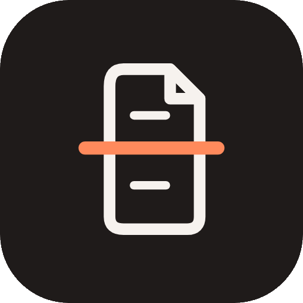

<div align="center">
  

  <h1>Pedeef: Offline PDF Toolkit for Android</h1>

  <p><b>All your PDF tools in one free app.<br/>Everything runs on your phone. No account, no network, no ads.</b></p>

  <a href="https://github.com/nekonaru/pedeef/releases/latest">
    
  </a>
  <a href="https://github.com/nekonaru/pedeef/actions/workflows/ci.yml">
    
  </a>
  
  
  
  
</div>

<br />

**English** | [Bahasa Indonesia](README.id.md)

---

## Table of Contents

- [About](#about)
- [Features](#features)
- [Requirements](#requirements)
- [Installation](#installation)
- [Usage](#usage)
- [Configuration](#configuration)
- [Project Structure](#project-structure)
- [Development](#development)
- [Testing](#testing)
- [Continuous Integration](#continuous-integration)
- [FAQ](#faq)
- [License](#license)

---

## About

Pedeef is a free PDF toolkit for Android. It merges, splits, compresses, scans, OCRs, redacts, signs and protects PDF files, and it does all of that on the device, with no account and no network access.

It is an original reimplementation of the open-source PDF Tools app (MIT, (c) 2026 SammyZi), with a rebuilt architecture, a bilingual UI and new tools of its own.

> _"Your documents never leave your phone unless you send them yourself."_

---

## Features

### Scan

| Feature | Description |
|---------|-------------|
| **Camera scan** | On-device document scanning with automatic edge detection, corner cleanup and deskew. |
| **Gallery import** | Images from your gallery become the same scans, one page per image. |
| **Searchable scans** | Optional OCR layer (invisible text) baked into the saved PDF, done on-device. |

### Combine and split

| Feature | Description |
|---------|-------------|
| **Merge PDFs** | Combine many PDFs into one; reorder files before merging. |
| **Alternate & Mix** | Interleave pages from two or more PDFs, one page from each in turn. |
| **Split** | Every page as its own file, or extract custom ranges like `1-3, 7, 9-`. |
| **Split by Text** | Start a new file at every page containing a phrase you choose. |
| **Split by Bookmarks** | Turn each bookmarked section into its own PDF. |
| **Split in Half** | Two files down the middle, or slice every page vertically or horizontally for book scans. |
| **Split by Size** | Break a large PDF into parts that each stay under a size limit. |
| **PDF to ZIP** | Bundle PDFs into a single ZIP archive. |

### Arrange pages

| Feature | Description |
|---------|-------------|
| **Organize Pages** | Reorder, rotate and delete pages, with page thumbnails. |
| **Rotate** | 90, 180 or 270 degrees, all pages or a selection. |
| **Flip** | Mirror pages horizontally, vertically or both. |
| **Multiple Pages per Sheet** | 2, 4, 6, 9 or 16 pages per sheet when printing. |
| **Crop & Resize** | Drag a crop frame per page, or fit every page to A4, A5, Letter or Legal. |

### Fill and mark up

| Feature | Description |
|---------|-------------|
| **Fill & Sign** | Type onto forms, place a drawn signature or a picture anywhere on any page. |
| **Watermark** | Diagonal CONFIDENTIAL-style text across every page, adjustable size and opacity. |
| **Page Numbers** | Bottom left, center or right; `1, 2, 3` or `Page 1 of N`. |
| **Redact** | Black out areas so their content is actually removed, not just covered. |
| **Edit PDF Details** | Title, author, subject and keywords. |

### Protect and shrink

| Feature | Description |
|---------|-------------|
| **Compress** | Recompress embedded photos to a level, or squeeze until the file fits a size target. |
| **OCR** | Add an invisible text layer to scans so find, select and copy work. |
| **Set Password** | AES-256 encryption; the PDF asks for a password before it opens. |
| **Remove Password** | Save a copy that opens without a password, restrictions removed too. |

### Automate

| Feature | Description |
|---------|-------------|
| **Workflow Builder** | Chain any tools in order and run them over one or many PDFs. |
| **Batch mode** | Single-file tools run on every selected PDF at once. |
| **Pins** | Pin the tools you use most to the top of Home. |

### New in Pedeef

| Feature | Description |
|---------|-------------|
| **Images to PDF** | Turn JPG and PNG images into one PDF, one page per image. |
| **PDF to Images** | Export pages as JPEG (a ZIP for multi-page documents). |
| **Extract Text** | Copy all text from a PDF into a plain `.txt` file. |
| **Bilingual UI** | English and Bahasa Indonesia, switchable in Settings. |
| **Better privacy** | No network permission, no broad storage permission, nothing to audit but your own files. |
| **Built-in viewer** | Smooth scrolling, zoom, search with match navigation, copy page text, on every supported Android version. |

---

## Requirements

| Dependency | Minimum Version | Notes |
|------------|-----------------|-------|
| **Android** | **7.0 (API 24)** | Built-in viewer and all tools work from Android 7 up. |
| **Google Play services** | recent | Only for the camera scanner. Every other feature works without it; the gallery import works everywhere. |
| **JDK** | **17** | To build from source. |
| **Android SDK** | compileSdk **36** | To build from source. |

> [!TIP]
> You do not need to build anything: grab the APK from the latest release instead.

### Never used a terminal? Start here

<details>
<summary><b>How to run the build commands on Windows, macOS and Linux</b></summary>

1. **Windows**: press `Win + R`, type `powershell`, press Enter.
2. **macOS**: open `Applications > Utilities > Terminal`.
3. **Linux**: open your terminal app (often `Ctrl + Alt + T`).
4. Move into the project folder with `cd` and run the commands from this README as written. On Windows, use `.\gradlew` instead of `./gradlew`.

</details>

---

## Installation

### Option A: Download the APK (easiest)

1. Open the [latest release](https://github.com/nekonaru/pedeef/releases/latest).
2. Download `pedeef-1.0.0.apk` (signed with the app's built-in debug key).
3. Tap the file to install. If Android warns about unknown sources, allow installing from your browser or file manager.
4. Open Pedeef.

> [!IMPORTANT]
> These APKs are signed with the app's built-in debug key, not a store upload key yet. If you use Google Play later, you may need to uninstall this build first.

### Option B: Build from source (for development)

#### 1. Get the code

<details>
<summary><b>I have Git installed</b></summary>

```bash
git clone https://github.com/nekonaru/pedeef.git
cd pedeef
```

</details>

<details>
<summary><b>I don't have Git</b></summary>

1. Open the [repository](https://github.com/nekonaru/pedeef) on GitHub.
2. Click **Code**, then **Download ZIP**.
3. Unzip it and open a terminal inside the `pedeef` folder.

</details>

#### 2. Install dependencies and verify

You need JDK 17 and the Android SDK (platform 36). Android Studio bundles both.

```bash
./gradlew :app:testDebugUnitTest
```

> [!IMPORTANT]
> The analyzer and all unit tests must pass. Do not continue with the next step until they are green.

#### 3. Build

```bash
./gradlew :app:assembleDebug   # APK at app/build/outputs/apk/debug/app-debug.apk
./gradlew :app:installDebug    # install on a connected phone
```

---

## Usage

### First launch

1. Pedeef opens with a welcome screen. Pick **English** or **Bahasa Indonesia**.
2. Tap **Get started**.
3. Pin the tools you use most: tap the pin icon on any tool card.

### Everyday use

- **Run a tool**: tap it, pick your PDFs, set the options, tap the action button. The result can be previewed, shared, opened in the built-in viewer, or saved into your Files tree inside the app.
- **Scan a document**: tap the scan card on Home. Pages are detected and cleaned automatically; scans are searchable if you leave OCR on.
- **Find your files**: the Files tab lists everything Pedeef saved, with folders, search, rename, move, share and delete. Pedeef never touches other apps' files.
- **Locked PDF?**: password-protected files ask for their password when you pick them; the password is never stored.

---

## Configuration

### Display Language

1. Open **Settings**.
2. Under **Language**, choose **English**, **Bahasa Indonesia** or **System**.

### Appearance

1. Open **Settings**.
2. Choose **System**, **Light** or **Dark**, then one of the three color schemes: **Ember**, **Black Cherry** or **Arctic Blue**.
3. On Android 12+, turn on **Dynamic color** to follow your wallpaper.

---

## Project Structure

```
pedeef/
  app/                      Android app module
    src/main/java/com/nekonaru/pedeef/
      MainActivity.kt       entry point
      engine/               PDF engine (PdfBox), pure ops + android ops
      tools/                tool catalog (26 tools, EN + ID)
      ui/                   screens: home, tool, files, viewer, settings, scan
      ui/theme/             themes (Ember, Cherry, Arctic) + typography
      i18n/                 English and Bahasa Indonesia strings
      data/                 files store, settings, pinned tools
    src/test/               JVM unit tests
  assets/                   logo and icon artwork
  docs/specs/               specs
  .github/workflows/        CI (build, tests, secret scan)
  README.md                 English documentation (source of truth)
  README.id.md              Bahasa Indonesia documentation
  CHANGELOG.md              release history (English)
  CHANGELOG.id.md           release history (Bahasa Indonesia)
```

---

## Development

### Adding a tool

1. Implement the operation in `engine/PdfEngine.kt` (bytes in, bytes out, no Android UI).
2. Add a bilingual entry in `tools/Tools.kt` (`TOOLS` list) with EN and ID title, description and CTA.
3. If it needs a custom editor, add one under `ui/tool/` and dispatch it from `ToolScreen.kt`.
4. Add a unit test in `app/src/test/` (pure logic) or note why it is device-only.
5. Add the tool to the Home catalog icons (`ui/home/HomeScreen.kt`).
6. Update `README.md` and `README.id.md` together.

> [!WARNING]
> Do not edit the generated Gradle wrapper JAR. Update it with the Gradle wrapper task instead.

### Adding a user-facing string

1. Add it to `Strings.kt` in both `En` and `Id`.
2. Use `LocalPedeefStrings.current` in the composable. No hard-coded UI strings.

---

## Testing

```bash
./gradlew :app:testDebugUnitTest
./gradlew :app:assembleDebug
```

| Check | Requirement |
|-------|-------------|
| Kotlin compile | Zero errors |
| Unit tests | All pass (26 tests) |
| Debug APK | Builds successfully |
| Secret scan | gitleaks reports zero findings |

---

## Continuous Integration

| Workflow | Purpose |
|----------|---------|
| `ci.yml` | Unit tests, debug APK build, gitleaks secret scan on every push, PR and tag `v*` |

---

## FAQ

<details>
<summary><b>Does Pedeef work without internet?</b></summary>

Yes. It has no network permission at all. Every tool, the scanner and OCR run on your phone.
</details>

<details>
<summary><b>Where are my files?</b></summary>

Inside Pedeef's private storage. Use the Files tab to open, rename, move, share, delete or export copies through the system file picker.
</details>

<details>
<summary><b>Why is there no Google Drive sync?</b></summary>

The app is deliberately network-free. Back up by exporting copies wherever you back up everything else.
</details>

<details>
<summary><b>A tool says my PDF is password-protected. What now?</b></summary>

Pick it again and type the password in the prompt. The password is used once and never saved.
</details>

<details>
<summary><b>The camera scanner does nothing on my phone.</b></summary>

The scanner needs Google Play services. On phones without it, use "Import from gallery" on the scan screen instead.
</details>

<details>
<summary><b>How is Pedeef licensed?</b></summary>

MIT. See [LICENSE](LICENSE) and [THIRD_PARTY_NOTICES.md](THIRD_PARTY_NOTICES.md).
</details>

---

## Author

<div align="center">

| [](https://github.com/nekonaru) |
|:---:|
| **Nicolas Dwi Dharma** |
| [github.com/nekonaru](https://github.com/nekonaru) |

</div>

---

## License

Distributed under the **MIT License**. See [`LICENSE`](LICENSE) for more information.
